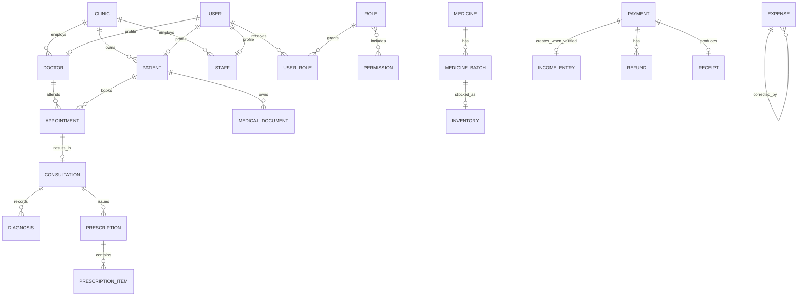

# Database Design

## Tenant isolation

`Clinic` is the tenant boundary. Every clinic-owned clinical, operational, inventory, and financial record has `clinicId`; services must scope every query by the authenticated clinic. Platform roles intentionally have a null clinic role assignment.

## Relationship map

## Integrity and history

- UUIDs, foreign keys, restrictive deletes, and composite tenant indexes preserve isolation and relationships.
- `Appointment` has a unique `(doctorId, startsAt)` slot plus a `version` field for optimistic update checks.
- `Payment.idempotencyKey` and `(provider, providerTransactionId)` are unique. A verified payment has a `verifiedAt` value and exactly one linked `IncomeEntry`; pending payments are receivables, not income. Payments and refunds are never soft-deleted.
- `Expense.previousVersionId`, `isCurrent`, and `correctionReason` preserve corrected expense history. Financial services create domain audit events in the same transaction as payment verification, refunds, and expense corrections.
- `MedicalDocument.previousVersionId`, `version`, and `isCurrent` preserve document history. Patients, users, medicines, and documents have limited soft deletion.
- Amounts use `Decimal(12,2)`; audit logs are append-only by application policy.
